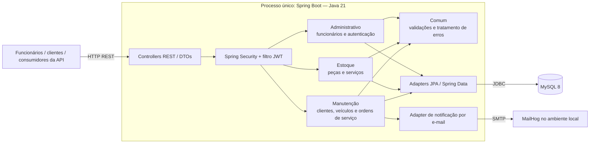
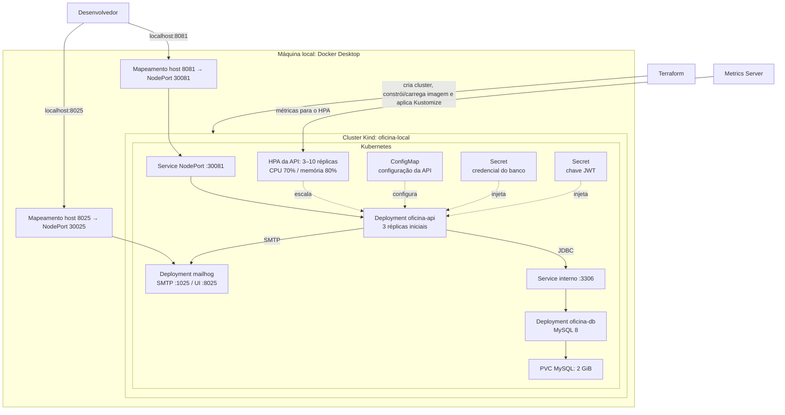

# Oficina Mecânica - SOAT Tech Challenge

[](https://sonarcloud.io/summary/new_code?id=mateuslourencao_soat-fase1-tech-challenge)
[](https://sonarcloud.io/summary/overall?id=mateuslourencao_soat-fase1-tech-challenge&branch=main)

## Sobre o Projeto

Este projeto é um MVP de um Sistema de Oficina Mecânica, desenvolvido como parte do Tech Challenge da Pós-Graduação em Arquitetura de Software (SOAT). A aplicação gerencia o fluxo administrativo, de estoque e de manutenção de uma oficina.

### Objetivos desta fase

Evoluir a aplicação desenvolvida na Fase 1 para garantir qualidade, resiliência e escalabilidade, incorporando práticas modernas de infraestrutura e automação.

### Como executar o projeto

Escolha um dos caminhos abaixo. Eles são alternativas independentes; siga as instruções da opção escolhida.

| Caminho | Quando usar | O que inicia | Instruções |
|---|---|---|---|
| Docker Compose | Desenvolver localmente sem Kubernetes | API, MySQL e MailHog em containers | [Execução com Docker Compose](#execução-local-com-docker-compose-recomendado) |
| Maven | Executar a API diretamente no computador | API; requer MySQL já instalado e configurado | [Execução local com Maven](#instalação-local) |
| Terraform + Kind | Cluster Kind local e implantação de validação | Consulte o [repositório de infraestrutura](https://github.com/mateuslourencao/oficina-k8s-infra) |

## Tecnologias Utilizadas

- **Java 21** - Linguagem principal
- **Spring Boot 4.1.0** - Framework para construção da aplicação
- **Spring Data JPA** - Abstração de persistência de dados
- **Spring Security & JWT** - Autenticação e autorização
- **MySQL 8.0** - Banco de dados relacional
- **Maven** - Gerenciador de dependências e build
- **Docker & Docker Compose** - Conteinerização da aplicação e banco de dados
- **SpringDoc OpenAPI** - Documentação da API
- **JaCoCo** - Relatórios de cobertura de testes
- **SonarQube** - Análise de qualidade e segurança

## Arquitetura

O projeto segue os princípios da **Arquitetura Hexagonal (Ports and Adapters)**, organizado em módulos de domínio para garantir separação de responsabilidades e facilitar a testabilidade.

### Módulos Principais

- **Administrativo** - Gestão de funcionários e autenticação
- **Estoque** - Controle de peças e serviços
- **Manutenção** - Gestão de clientes, veículos e ordens de serviço

### Desenho da arquitetura

A aplicação é um **monólito modular**: os módulos compartilham o mesmo processo Spring Boot e o mesmo banco MySQL, mas separam responsabilidades por domínio. A infraestrutura Kubernetes local está documentada no [repositório oficina-k8s-infra](https://github.com/mateuslourencao/oficina-k8s-infra); a pipeline descrita abaixo cria um cluster descartável para validar a implantação.

#### Componentes da aplicação



Controllers expõem a API REST e encaminham os casos de uso dos módulos. A autenticação gera JWT e protege as rotas administrativas; o fluxo público de aprovação/acompanhamento da OS permanece exposto conforme os endpoints da aplicação. Os adapters JPA persistem os dados no MySQL, e o adapter de e-mail usa SMTP (MailHog para desenvolvimento e validação).

#### Infraestrutura local



#### Fluxo de CI e deploy de validação

```mermaid
flowchart LR
    EVENT[Push em homolog/main ou Pull Request] --> TEST[Testes Maven]
    TEST -->|sucesso| SONAR[Análise SonarCloud]
    SONAR --> DECISION{Tipo de evento}
    DECISION -->|Pull Request| BUILD[Build do JAR e imagem Docker]
    BUILD --> KIND[Criar cluster Kind temporário]
    KIND --> METRICS[Instalar Metrics Server]
    METRICS --> LOAD[Carregar imagem no Kind]
    LOAD --> DBAPPLY[kubectl apply -k oficina-db]
    DBAPPLY --> DBREADY[Aguardar MySQL]
    DBREADY --> APPLY[kubectl apply -k .]
    APPLY --> READY[Aguardar API e MailHog]
    READY --> HPA[Confirmar HPA aplicado]
    HPA --> CLEAN[Remover cluster temporário — sempre]
    READY -. falha .-> CLEAN
    DECISION -->|Push homolog/main| DISPATCH[Disparar workflow da infraestrutura]
    DISPATCH --> RUNNER[Runner Windows self-hosted local]
    RUNNER --> TF[Terraform apply]
    TF --> PERSISTENT[Cluster Kind homolog ou produção local]
```



O workflow `.github/workflows/main.yml` executa testes e SonarCloud nos pushes e PRs. Em PRs, ele valida a implantação num Kind temporário aplicando primeiro os manifests do [oficina-db](https://github.com/mateuslourencao/oficina-db), aguardando o MySQL, e depois aplicando os manifests da aplicação. Em pushes aprovados para `homolog` ou `main`, solicita ao [repositório oficina-k8s-infra](https://github.com/mateuslourencao/oficina-k8s-infra) o deploy automático local, que segue a mesma ordem.

## Configurações iniciais

### Infraestrutura Kubernetes

A infraestrutura Terraform do cluster está no [repositório oficina-k8s-infra](https://github.com/mateuslourencao/oficina-k8s-infra). Os recursos MySQL e o schema pertencem ao [repositório oficina-db](https://github.com/mateuslourencao/oficina-db). O Terraform aplica o Kustomize do banco e aguarda o MySQL ficar pronto antes de aplicar os manifests da aplicação; a pipeline de PR também valida nessa ordem.

### Pré-requisitos

- Docker e Docker Compose instalados
- Java 21 e Maven (opcional, para execução local)

### Execução local com Docker Compose (Recomendado)

O banco é iniciado pelo repositório `oficina-db`. Primeiro crie o banco e a rede compartilhada; depois, na raiz deste repositório, inicie a aplicação:

```bash
docker compose -f ../oficina-db/docker-compose.yml up -d
docker compose up --build
```

Isso iniciará:
1. Container MySQL (`oficina-mysql`) na porta `3306`, inicializado pelo schema do repositório `oficina-db`
2. Container MailHog (`oficina-mailhog`) com SMTP na porta `1025` e interface web na porta `8025`
3. Container da aplicação (`oficina-app`) na porta `8081`

O banco precisa estar em execução antes de iniciar a aplicação. Se a API falhar durante a inicialização, confira `docker compose logs app` e os logs do banco com `docker compose -f ../oficina-db/docker-compose.yml logs db`.

Os e-mails enviados pela aplicação ficam disponíveis para consulta em:

**[http://localhost:8025](http://localhost:8025)**

### Instalação Local

1. Certifique-se de ter um banco MySQL rodando
2. Configure as variáveis de ambiente ou edite `src/main/resources/application.properties`:
   - `DB_URL` - URL de conexão (ex: `jdbc:mysql://localhost:3306/oficina`)
   - `DB_USERNAME` - Usuário do banco
   - `DB_PASSWORD` - Senha do banco

3. Execute via Maven:

```bash
mvn clean spring-boot:run
```

### Banco de Dados

O Hibernate está configurado para criar tabelas automaticamente (`ddl-auto: update`) no Docker Compose. O schema inicial foi movido para o repositório [oficina-db](https://github.com/mateuslourencao/oficina-db):

- **Arquivo**: [`schema.sql`](https://github.com/mateuslourencao/oficina-db/blob/main/schema.sql)
- **Conteúdo**: definição inicial das tabelas e carga de desenvolvimento

## Documentação da API

Com a aplicação rodando, acesse a documentação interativa do Swagger:

**[http://localhost:8081/swagger-ui.html](http://localhost:8081/swagger-ui.html)**

A collection completa para importar no Insomnia está em [`oficina-insomnia-collection.json`](oficina-insomnia-collection.json). A especificação OpenAPI também pode ser consultada em [http://localhost:8081/v3/api-docs](http://localhost:8081/v3/api-docs).

### Principais Endpoints

- `/api/v1/administrativo/autenticacao` - Login de funcionários
- `/api/v1/administrativo/funcionarios` - Gestão de funcionários
- `/api/v1/pecas` - Gestão de peças em estoque
- `/api/v1/servicos` - Gestão de serviços oferecidos
- `/api/v1/clientes` - Gestão de clientes
- `/api/v1/veiculos` - Gestão de veículos
- `/api/v1/ordensdeservico` - Abertura e acompanhamento de ordens de serviço

### Testando com Insomnia

Uma collection do Insomnia está disponível para facilitar os testes:

1. Abra o Insomnia
2. Clique em **Import** e selecione `oficina-insomnia-collection.json`
3. Configure a variável `base_url` para `http://localhost:8081/api/v1` (já pré-configurada)
4. Faça login no endpoint de **Autenticação** para obter o token JWT
5. Copie o token para a variável `jwt_token` no Environment

## Testes e Qualidade

### Executar Testes

```bash
mvn test
```

### Pipeline GitHub Actions

O workflow executa testes automatizados e análise SonarCloud. Em Pull Requests, também cria um cluster Kind temporário, aplica os manifests do banco e aguarda o MySQL antes de aplicar e validar a API. Em pushes para `homolog` e `main`, dispara o deploy local pelo repositório de infraestrutura.

### Relatório de Cobertura (JaCoCo)

```bash
mvn verify
```

O relatório será gerado em `target/site/jacoco/index.html`.

A configuração do JaCoCo no `pom.xml` exclui classes de configuração, DTOs, entidades e classes geradas, focando na lógica de negócio (Use Cases e Modelos).

### Análise com SonarQube

Este projeto integra SonarQube para garantir cobertura de testes e segurança.

#### Setup Localmente

**1. Subir o servidor SonarQube via Docker**

```bash
docker run -d --name sonarqube -p 9000:9000 sonarqube:latest
```

(Aguarde 1-2 minutos para inicialização)

**2. Primeiro Acesso**

- Acesse: **http://localhost:9000**
- Login padrão: `admin` / `admin`
- O sistema pedirá para criar uma nova senha

**3. Criar Projeto e Token**

- Clique em **Create Project > Local (Manually)**
- Project name: `oficina-api`
- Escolha análise **Locally**
- Crie um token (começa com `sqp_`) e copie-o

**4. Executar Análise**

Na raiz do projeto, execute:

```bash
./mvnw clean verify sonar:sonar \
  -Dsonar.projectKey=oficina-api \
  -Dsonar.host.url=http://localhost:9000 \
  -Dsonar.token=SEU_TOKEN_AQUI
```

**5. Visualizar Resultados**

Volte a **http://localhost:9000** para ver o dashboard com Security Hotspots, Code Smells e cobertura de testes.

### Dashboard Público

Acesse o relatório completo no SonarCloud:

**[Dashboard SonarCloud](https://sonarcloud.io/summary/overall?id=mateuslourencao_soat-fase1-tech-challenge&branch=main)**

## Licença

Este projeto foi desenvolvido como parte do SOAT Tech Challenge.

## Contribuidores

Mateus Lourenção - [GitHub](https://github.com/mateuslourencao)

Pedro Ruiz - [GitHub](https://github.com/opedro)


